# elevendash

Match analysis for **Eleven Table Tennis** on Meta Quest, from the game's own log files.

[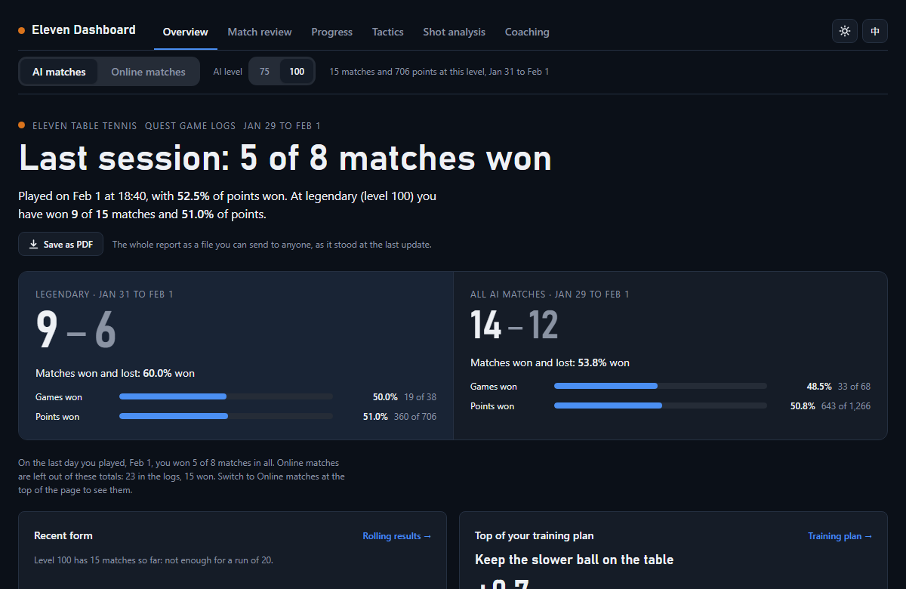](https://glki6.github.io/elevendash/demo/)

*The pictures on this page are of the [demo](https://glki6.github.io/elevendash/demo/), built from made-up matches.*

It copies the logs off your
headset over Wi-Fi, works out every match, game, point and shot, and writes a dashboard you can open in any browser:
win rates by session and AI level, a session report, a point-by-point replay of every match drawn from the ball
contacts (from above, or in 3D with a slow-motion replay of the shot that decided the point and its spin), serve and return breakdowns, a shot explorer that finds any of your shots by the ball that came at you and lists the kinds of ball you miss most and shows how your misses differ from the shots you land, rolling win rates with the range chance allows and how you play from the first match of a session to the last, your numbers over any matches you pick set against your other matches or against an earlier stretch (then and now, with the mix of balls you faced held the same), a
picture of any match to send or post, your own notes on any match, and a training plan ranked by how many points each
item is worth.

No account, no hosting, no AI service: everything runs on your computer with plain Python. The app opens your
dashboard in your browser with an **Import new logs** button, and the dashboard is also a single HTML file that works
offline: send it to a coach or a friend, or put it on any static host. Notes you write on matches stay on your
computer, never in the file, so they stay behind when you send it.

elevendash is built for matches against the AI. Matches against people online have a side of their own, with
ratings: it should work, but it is close to untested on real matches
(see [Against the AI, and against people online](#against-the-ai-and-against-people-online)).

> elevendash is inspired by [11hero](https://11hero.com). Its match metrics follow 11hero's definitions and were
> checked against it on a real match (see `research/CALIBRATION.md`). It is an independent project, not affiliated
> with or endorsed by For Fun Labs, Meta or 11hero.

## Get started

**Windows:** download `Eleven-Dashboard-windows.zip` from the
[latest release](https://github.com/glki6/elevendash/releases/latest), unzip it anywhere and open
**Eleven Dashboard.exe**. It isn't code-signed, so the first time Windows may show "Windows protected your PC":
choose **More info**, then **Run anyway**. In the app, **Settings › Add to Start menu and desktop** gives you a
shortcut for next time.

**macOS, Linux, or Windows with Python 3.10 or newer:** with [pipx](https://pipx.pypa.io),

```
pipx install git+https://github.com/glki6/elevendash
elevendash app
```

(`elevendash app --shortcut` adds Eleven Dashboard to the Start menu and the desktop on Windows.)

Then:

1. On the headset, open Eleven, then **Settings › Network Settings › File Sharing**, and start it. It shows an address
   such as `192.168.1.20:8090`. The computer must be on the same Wi-Fi.
2. In the app, open **Settings**, enter that address and press **Save**.
3. Press **Import new logs**. It copies the logs that are new since last time, rebuilds the data and reloads the page
   with your new session. Do this after every session: the headset keeps only its most recent logs, and elevendash
   keeps a copy of every log it has seen.

No Wi-Fi sharing? Copy the `ALL-*.log` files off the headset another way (a USB cable, a file manager) and use
**From files…**.

The app is a small web server that only this computer can reach. It answers only the pages it served itself, and
stops on its own 20 minutes after the last dashboard tab is closed. Your logs and results are kept in
`Documents/elevendash` (or the folder named by `--dir` or `ELEVENDASH_HOME`); **Settings** shows where and opens it.

### On your phone

With [Tailscale](https://tailscale.com) on the computer and the phone (signed in to the same account), open
**Settings**, tick **Open on my phone** and scan the code with the phone's camera. If Windows asks whether to allow the
app on private networks, allow it. The phone gets the same dashboard and the same Import button, from anywhere your
phone has a connection, as long as the computer is on with the app running: tick **Start with Windows** to keep it
running from sign-in (it doesn't open a browser tab then, and while the phone link is on it doesn't stop by itself).
**New link** ends the old one, for a lost phone. See `SECURITY.md`.

## What it looks like

### Session report

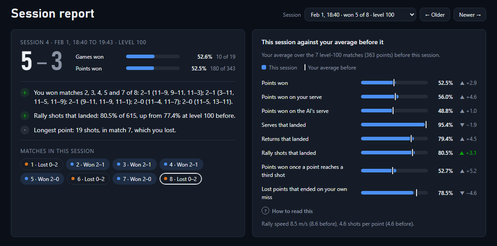

Written from the logs after every session: what you won, what changed, and each number against your average at the same AI level before it.

### Point by point

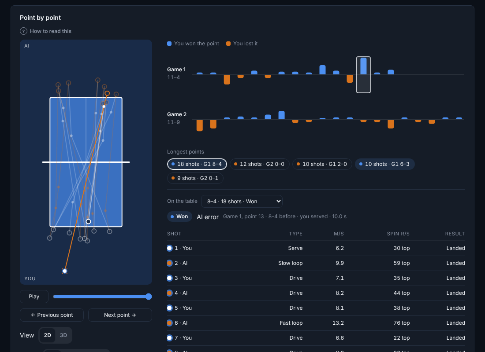

Every point of a match as a bar. Click one to play it back from the ball contacts, with the type, speed and spin of each shot.

### 3D replay

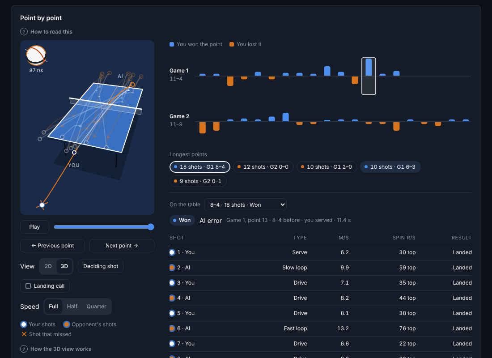

The same point in 3D, with the spin of the ball shown in the corner. "Deciding shot" replays the last shot in slow motion with the camera following the ball.

### Match card

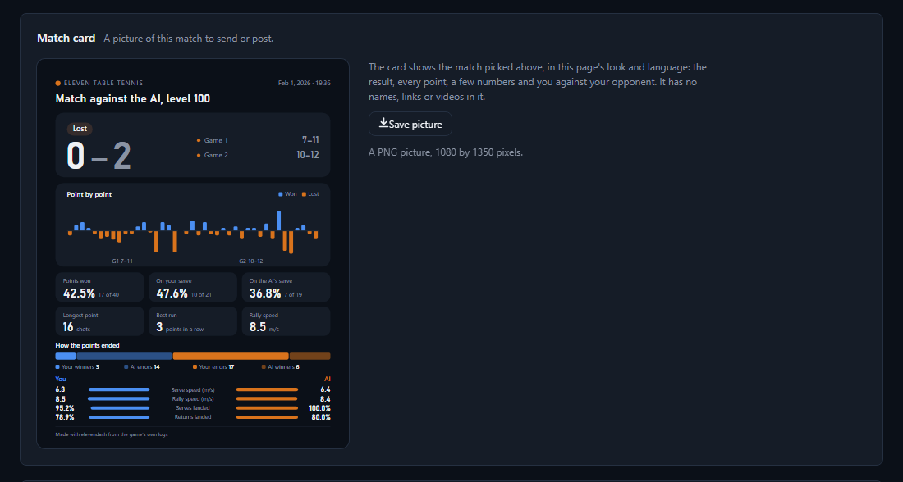

A picture of any match to send or post. It has no names, links or videos in it.

### Session card

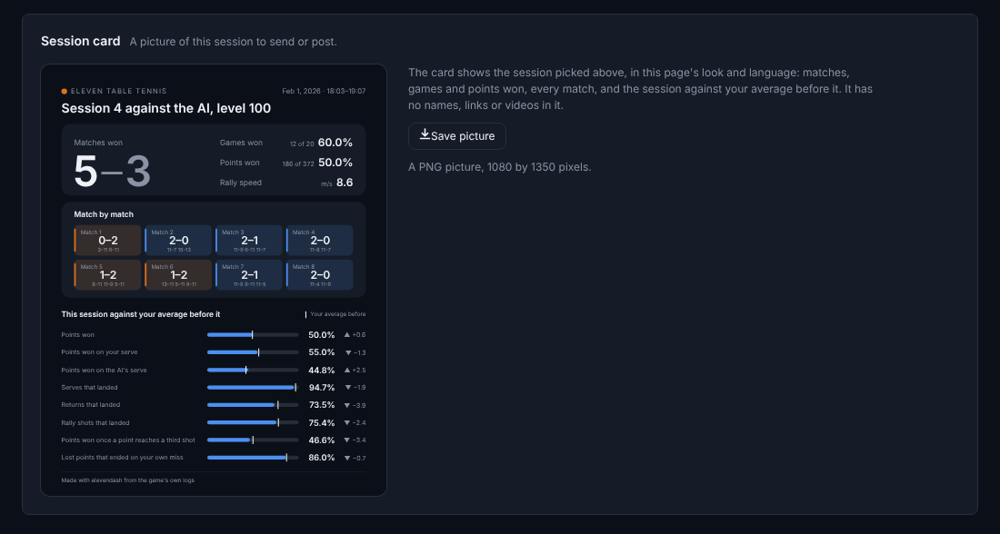

The same for a whole session, under the session report: matches, games and points won, every match, and the session
against your average before it.

### Training plan

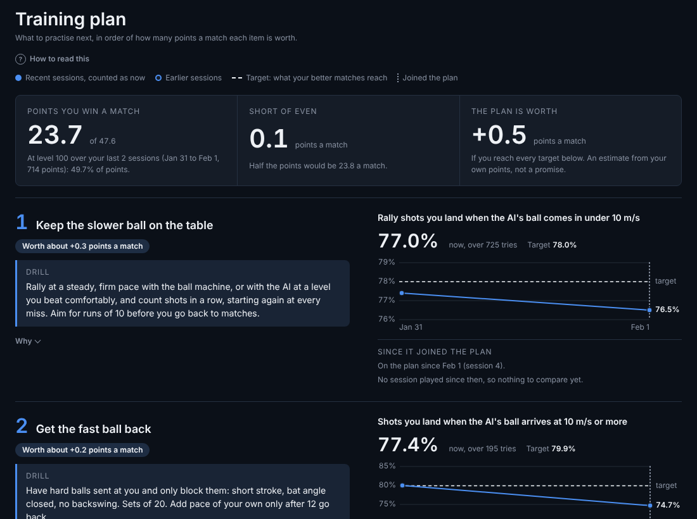

What to practise next, ranked by how many points a match each item is worth, with a drill, a target taken from the matches you won, and the trend.

### What works for you

The other side of the training plan: your three best serves, the stroke that wins you the most points against each kind of rally ball, the patterns that win clearly more than the rest, and where and how hard your winning shots go. Worked out again at every update, each line one click from the card and the replays behind it.

### Shot explorer

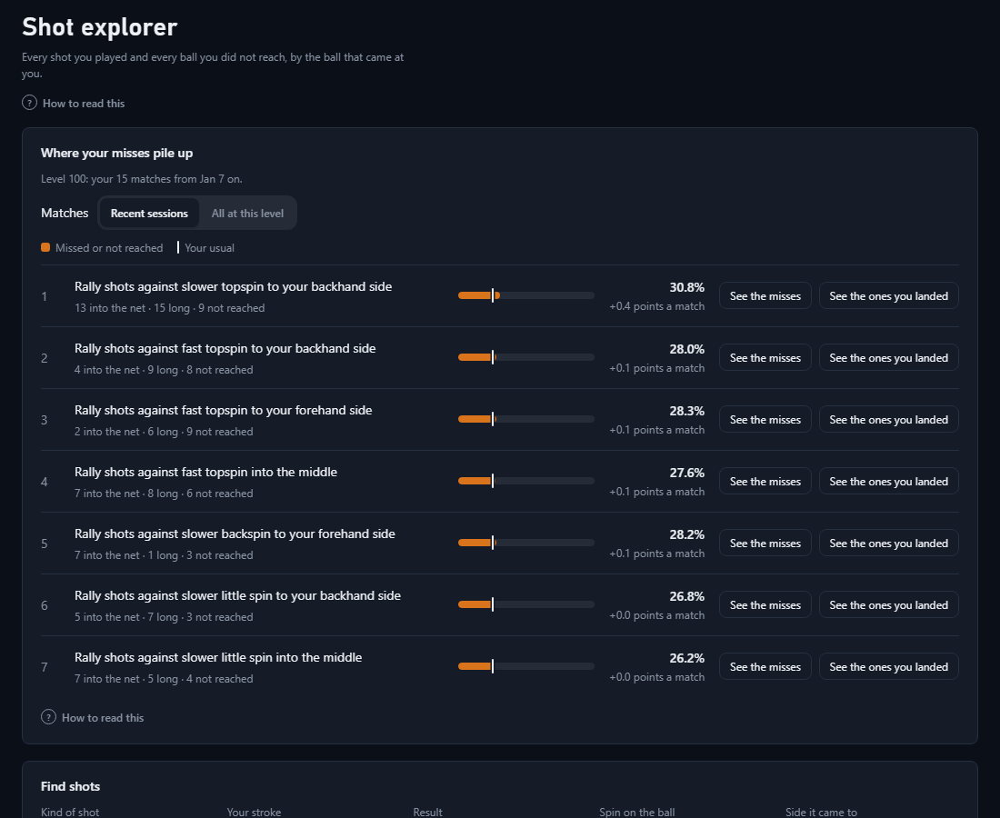

The kinds of ball you miss most, each one click away from its replays, and a filter that finds any shot by the ball that came at you. For the balls you pick it also compares your strokes, sets your misses against the shots you landed, and shows what happens after you attack: how often the attack wins the point there, how often it comes back, and how those points go. A map of the far half shows where your shots land and the points you win from each part of the table, by depth, by side and by direction (cross-court or down the line). Another card answers how hard to hit: the share you land and the points you win at each speed off your bat, by whether the ball was still rising and how soon after the bounce you met it, with a speed by spin grid of what lands. And a chart follows one skill over time: for the balls you pick, the share you landed in each session, week or month with its likely range, apart from whether you won the matches.

### Form and stamina

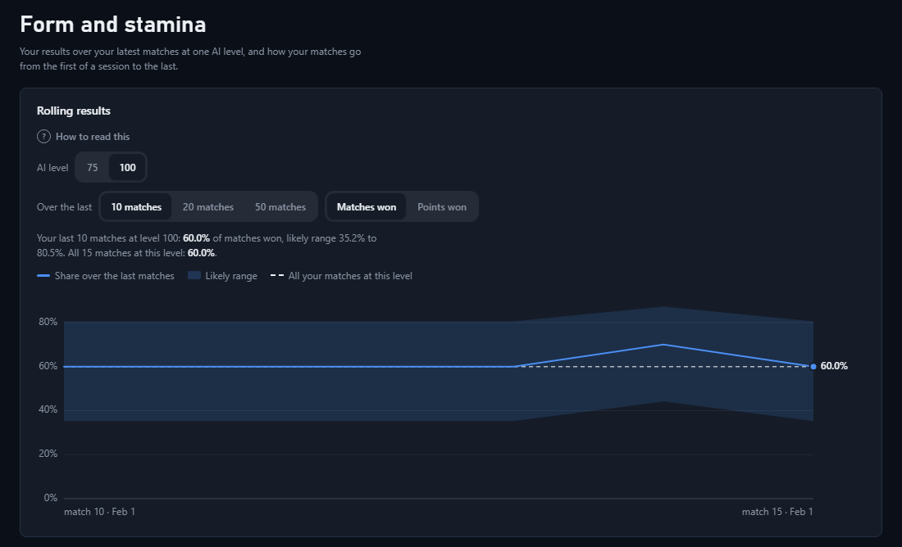

Rolling win rates with the range chance allows, so a lucky week does not look like progress, and how you play from the first match of a session to the last.

### Serves and returns

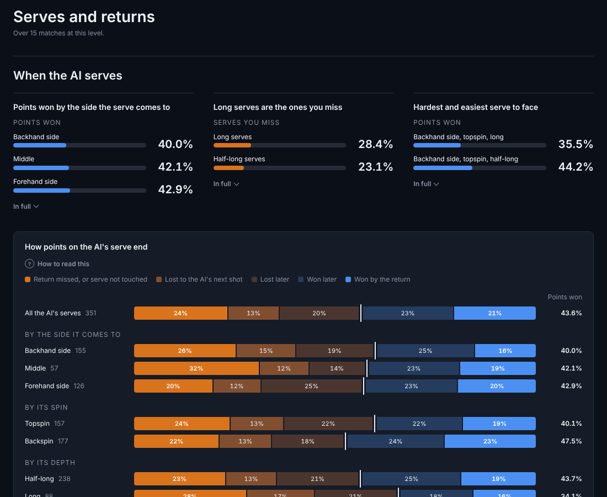

Where points on each serve end: by the side, spin and depth of the serve, for the AI's serves and your own. Below that, the first shots of a point as one pattern (your serve, the ball that came back and your third ball; or the AI's serve, your return, its next ball and your fourth), with the points you win from each pattern against your average, and its points one click from the replay.

### Online matches and ratings

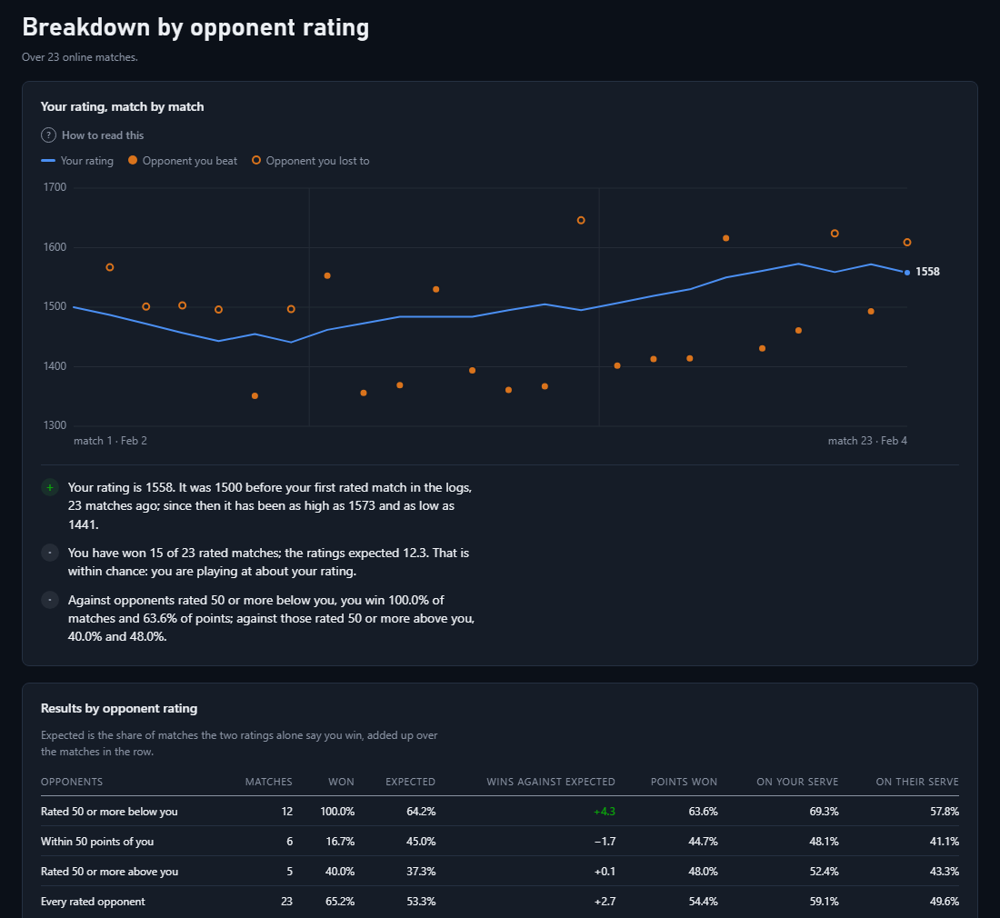

A switch at the top turns the whole dashboard from your matches against the AI to your matches against people online. The online side adds your rating match by match, and your results set against what the ratings alone expect.

## Try it without a Quest

The demo is online at https://glki6.github.io/elevendash/demo/. To build it yourself:

```
elevendash demo
```

This writes `elevendash-demo/`: seven sessions of made-up matches, four against the AI and three online, built into a dashboard at
`elevendash-demo/site/index.html`. The logs are generated (`src/elevendash/sample.py`) and hold no account data.
`elevendash --dir elevendash-demo app` opens it in the app.

## Against the AI, and against people online

elevendash is built for matches against the AI, and nearly all of its testing is on them. Against the AI, the game
logs every ball contact by both players, so everything on the dashboard works: the replay, rally and serve analysis,
the 11hero metrics for both sides, the match and session cards and the training plan.

Matches against people online are the dashboard's second side. A switch at the top of the page turns all of it from
your AI matches to your online ones: the same session report, training plan, shot explorer and breakdowns, added up
over your online matches and worded for an opponent. The two sides are added up apart, so neither changes the other's
totals. The log holds your own shots as ball contacts and your opponent's as the messages their game sends. It also
holds both players' ratings as each match starts and what a ranked match is worth, so the online side adds your rating
match by match and your results against lower, equal and higher rated opponents, set against what the ratings alone
expect. No opponent's name appears anywhere.

The online side should work, but treat it as untested. It is built and checked on generated matches, and on one real
online match, where every hit of both players and their metrics matched 11hero's. One match cannot show what a
season of online play looks like, so expect rough edges, and please report them (see `CONTRIBUTING.md`). The misses
reel and the session videos are still made for sessions against the AI only.

## Privacy first

Eleven's log files contain your **Eleven and Meta account tokens**, your platform user id and name, the names of people
you played online, and sometimes your location. elevendash keeps the logs in your workspace and never sends them
anywhere. The dashboard file holds match data only, never logs or tokens.

**Never share your `logs` folder or a raw log.** If you need to show one (for a bug report), make a redacted copy and
read it before you share it:

```
elevendash redact logs/ALL-01.05.2026.6.30.00.PM.log redacted.log
```

The only network requests elevendash makes are two read-only calls to your own Quest on your own network
(`/getListing` and `/downloadFile`). It never uploads to the headset or deletes anything there. The app's server
listens on this computer only (127.0.0.1). See `SECURITY.md`.

## From source

Python 3.10 or newer. No other packages are needed for the dashboard.

```
git clone https://github.com/glki6/elevendash.git
cd elevendash
python -m venv .venv
.venv\Scripts\activate            (Windows)     or     source .venv/bin/activate     (macOS, Linux)
pip install -e .
```

`packaging/windows/build.ps1` builds the Windows app with PyInstaller (`.github/workflows/release.yml` does it for
each release).

## Command line

Everything the app does also works as commands, for scripts and for people who prefer a terminal:

```
elevendash init ~/eleven                      a private folder for your logs and results
cd ~/eleven
elevendash fetch --quest 192.168.1.20         the address Eleven shows under File Sharing (remembered after this)
elevendash update                             fetch, build, print the session report, write the dashboard
```

Then open `site/index.html`. After every session, `elevendash update` again.

To get the logs over Wi-Fi: in Eleven open **Settings > Network Settings > File Sharing** and start it; it shows an
address such as `192.168.1.20:8090`. The computer must be on the same network. The headset keeps only its most recent
launches, so fetch after each session; elevendash keeps a copy of every log it has seen.

No Wi-Fi sharing? Copy the `ALL-*.log` files off the headset any other way (USB cable, a file manager) and run
`elevendash import <folder>`.

| Command | What it does |
|---|---|
| `elevendash init [DIR] [--quest HOST]` | Make a workspace |
| `elevendash fetch [--quest HOST]` | Copy new logs from the Quest |
| `elevendash import PATH ...` | Copy logs from files or folders |
| `elevendash build` | Turn the logs into match data (`build/`, one JSON file per dataset) |
| `elevendash report` | Print the last session: results, notes, session and all-time win rates |
| `elevendash site [--out FILE] [--no-videos] [--theme dark\|light] [--lang en\|zh]` | Write the dashboard (`site/index.html`) |
| `elevendash pdf [--out FILE] [--theme dark\|light] [--lang en\|zh]` | Print the dashboard to a PDF (needs Chrome, Edge or Chromium) |
| `elevendash update [--offline]` | fetch + build + report + site |
| `elevendash app [--shortcut] [--no-browser] [--port N]` | The dashboard in your browser with an Import button; `--shortcut` adds it to the Start menu and desktop (Windows) |
| `elevendash config [hand=auto\|right\|left] [theme=dark\|light] [lang=en\|zh]` | Show or change the workspace settings |
| `elevendash demo [DIR]` | A workspace of made-up matches and its dashboard |
| `elevendash redact LOG OUT` | A copy of a log without account, people or location data |

Add `--nice` to any command to run it at the lowest CPU priority. Commands use the workspace in the current folder,
or `--dir`, or `ELEVENDASH_HOME`.

## Sharing the dashboard

`site/index.html` is self-contained (about 5 MB for a few hundred matches; the data in it is compressed, and a browser
from 2023 or later unpacks it as it opens): send it as a file, or upload it to any
static host (GitHub Pages, Netlify, Cloudflare Pages). A view's level, session and match are kept in the address after
`#`, so a link can open a particular match. In the browser, Save as PDF prints it.

If you upload session videos (below), the dashboard links to them. `--no-videos` leaves those links out.

The dashboard opens dark and in English; switches at the top change the look (dark or light) and the language
(English or Traditional Chinese), and the address remembers the choice. `?theme=light` or `?lang=zh` on the file's
address, or `elevendash config theme=light lang=zh`, changes what it opens with. The PDF follows the same settings.

## Optional: session videos on YouTube

`youtube/` uploads a session's headset recording, an automatic highlight reel and a reel of the balls you missed most
(a few of the misses, then the same ball landed) to your own YouTube channel, always as unlisted, and lines the
recording up with the log by the sound of the ball, so every point on the dashboard gets a "watch" link. It needs `pip install -e ".[youtube]"`, ffmpeg on the PATH, and your own Google Cloud OAuth client
(Desktop app, YouTube Data API v3). See the top of `youtube/yt.py`. The reel's captions use a Windows font for now.

## How it works

| Path | What it is |
|---|---|
| `src/elevendash/extract.py` | Log to matches, games, points, ball contacts (bat, table, net, floor) |
| `src/elevendash/health.py` | Warns after a build when a log does not read as expected, as after a game update that changes the log format |
| `src/elevendash/metrics.py` | Per-player match metrics with 11hero's definitions |
| `src/elevendash/builddata.py` | All dashboard datasets, including the written session notes and the training plan, by fixed rules |
| `src/elevendash/web/` | The dashboard page (`index.template.html`), its small runtime, look and the d3 chart library |
| `src/elevendash/i18n.py`, `web/zh-Hant.json` | The two languages: the page's text, chart labels and written notes, keyed by the English |
| `src/elevendash/voice.py` | The wording for matches against people: every sentence that names the AI or an AI level, reworded by rule |
| `src/elevendash/site.py`, `pdf.py` | The single-file dashboard and its PDF |
| `src/elevendash/fetch.py`, `cli.py`, `workspace.py` | Getting logs, the command line, where your data lives |
| `src/elevendash/app.py`, `web/app.*`, `web/welcome.html` | The app: a local server, the Import bar above the dashboard, notes kept in the workspace |
| `packaging/windows/` | The Windows app (PyInstaller) and its release notes |
| `src/elevendash/sample.py`, `redact.py` | Generated logs for the demo and tests; redacted copies of real logs |
| `tests/` | `python -m unittest discover -s tests` |
| `youtube/` | Optional video uploads and highlight reels |
| `integrations/claude_dashboard/` | Keeps a hosted copy of the dashboard on claude.ai in step with a workspace (optional) |
| `research/` | Calibration against 11hero |
| `tools/pagetest/` | Opens a built dashboard in headless Chrome and Firefox and checks that it works: `python tools/pagetest/run.py site/index.html` |
| `tools/prepush/`, `tools/hooks/` | A check, run by git before every push, that nothing private from your workspace is about to be published |
| `tools/fxtest/` | Scroll tests in a private headless Firefox |

Coordinates are your view: your half of the table is z < 0 and +x is your right. Which side is your backhand comes
from the paddle hand the game records in the log (`elevendash config hand=left` or `hand=right` overrides it).

To change a Chinese wording, edit `web/zh-Hant.json`. After changing any English text, run
`python -I -c "import sys; sys.path.insert(0, 'src'); from elevendash import i18n; i18n.check()"` from the repository:
it lists text with no Chinese yet, entries nothing uses any more, and placeholders that do not match.

## Status

Early, and so far tested on one player's logs (Quest 3S, AI levels 75 to 100, a few hundred matches), plus generated
logs. The dashboard opens on your main level (the AI level with the most points in your last five sessions), and its
findings are written from your numbers by fixed rules in `builddata.py`. Online play: see "Against the AI, and against
people online" above. Left-handed play is handled but has only been tested by forcing `hand=left` on right-handed logs. Logs
from other headsets, game versions and online matches are welcome (redacted): see `CONTRIBUTING.md`. What comes next
is in [`ROADMAP.md`](ROADMAP.md).

## Backstory

I had never played table tennis before Eleven. I got into the game, wanted to get better at it, and wanted to know
what was losing me points instead of guessing. [11hero](https://11hero.com) showed me what match analysis for Eleven
can look like, and elevendash is inspired by it: the same kind of numbers, worked out on my own computer from the
game's logs, for the matches I play most, which are against the AI. I play with a
[SolidSlime paddle adapter](https://vrpingpong.net), made by the same people behind 11hero.

I am one player with one headset, so this is built around how I play. If it helps you improve too, or it gets
something wrong on your logs, I would like to hear about it.

## Licence

MIT, see `LICENSE`. The bundled D3 chart library is under the ISC licence; see `THIRD_PARTY_NOTICES.md`.
